  

# 🚀 Awesome DevOps & Cluster Infrastructure Management

**A curated, production-tested showcase of SaaS/hosted platforms, fleet orchestrators, and open-source GitHub projects for modern DevOps, Site Reliability Engineers (SREs), and platform architects.**

*Master Multi-Cluster Kubernetes (K8s), Bare-Metal & Hybrid Cloud Provisioning, Immutable Operating Systems, GitOps Continuous Delivery, and Infrastructure-as-Code (IaC).*

---

---

## 📑 Table of Contents

- [🌐 Sector Overview & Market Dynamics](#-sector-overview--market-dynamics)
- [🏢 SaaS & Hosted Commercial Platforms](#-saas--hosted-commercial-platforms)
- [💻 Open-Source Infrastructure Projects (Ranked by Stars)](#-open-source-infrastructure-projects-ranked-by-stars)
- [🛠️ Recommended Production Architectural Stacks](#️-recommended-production-architectural-stacks)
- [🤝 How to Contribute](#-how-to-contribute)
- [📈 Star History](#-star-history)
- [💖 Support & Sponsorship](#-support--sponsorship)
- [⚠️ Disclaimer](#️-disclaimer)

---

## 🌐 Sector Overview & Market Dynamics

The cloud-native cluster and Kubernetes infrastructure management market is estimated at **$2.6B–$3.1B in 2025–2026**, expanding rapidly at an estimated **17%–24% CAGR** toward **$6B+ by 2030** driven by multi-cloud fleet governance, enterprise platform engineering, and AI/GPU workload orchestration. 

The sector exhibits **moderate market concentration**: 
- **Hyperscalers & Core Runtimes:** AWS (EKS), Microsoft (Azure Arc / AKS), Google (Distributed Cloud / GKE), and IBM/Red Hat (OpenShift) heavily dominate primary enterprise cloud infrastructure spend.
- **Independent Fleet & Management Layer:** Concurrently, a **moderately fragmented** ecosystem of specialized independent platforms (SUSE/Rancher, Broadcom Tanzu, Mirantis, Spectro Cloud, Platform9, Portainer) thrives because modern enterprises actively deploy independent multi-cluster management and GitOps layers across hybrid on-premise datacenters, bare-metal servers, and edge environments to circumvent single-cloud vendor lock-in.

---

## 🏢 SaaS & Hosted Commercial Platforms

> *Commercial hosted control planes, multi-cluster fleet management consoles, and hybrid cloud orchestrators sorted in descending order by company valuation/revenue.*

| Platform | Parent Company / Backer | Market Size / Valuation / Revenue | Description | Specific Pricing | Free Tier / Trial Limit |
| :--- | :--- | :--- | :--- | :--- | :--- |
| **[Microsoft Azure Arc](https://microsoft.com)** | Microsoft Corporation | Market Cap: ~$3.1T+ / Revenue: ~$245B+ (FY24) | Hybrid & multi-cloud bridge projecting external Kubernetes clusters into Azure ARM for unified policy and GitOps. | Free core cluster connection; Add-ons start at $2.00/vCPU/month (GitOps configuration) & $3.00/vCPU/month (Azure Policy). | Free connection & inventory; first 6 vCPUs/subscription free for configuration & policy add-ons. |
| **[Google Distributed Cloud](https://google.com)** | Alphabet Inc. (Google) | Market Cap: ~$2.1T+ / Revenue: ~$307B+ (FY24) | Enterprise hybrid & multi-cloud Kubernetes control plane extending GKE fleet governance across bare-metal & cloud nodes. | Starts at $35/vCPU/month (Connected tier; 96 vCPU site minimum; 5-yr commitment from $1,344/month/site). | 90-day free trial with $300 cloud credits across Google Cloud services (GDC bare-metal/air-gapped requires sales PoC). |
| **[Amazon Elastic Kubernetes Service (AWS EKS)](https://amazon.com)** | Amazon.com, Inc. (AWS) | Market Cap: ~$2.1T+ / Revenue: ~$107B+ AWS ARR (FY24) | Managed Kubernetes control-plane and hybrid-node (`EKS Anywhere`) orchestration with IAM, Karpenter, and Fargate. | Managed EKS: $0.10/cluster/hour ($73/month/cluster) + EC2/Fargate worker compute; EKS Anywhere Enterprise: $2,000/cluster/month (1-yr term). | EKS Anywhere (self-managed) is 100% free open-source; EKS managed control plane has no free tier (covered by standard AWS new-account promotional credits if active). |
| **[VMware Tanzu Platform](https://vmware.com)** | Broadcom Inc. | Market Cap: ~$750B+ / Revenue: ~$51B+ (FY24) | Enterprise cloud-native Kubernetes platform and Tanzu Mission Control fleet manager across vSphere, public clouds, and edge. | Bundled via vSphere Foundation (VVF) starting at ~$135/core/year or VMware Cloud Foundation (VCF) at ~$350/core/year (16-core CPU minimum). | 30-day evaluation trial license for Tanzu components; free hands-on access via VMware Hands-on Labs (HOL-2132). |
| **[Red Hat OpenShift](https://redhat.com)** | IBM / Red Hat | IBM Market Cap: ~$200B+ / Red Hat Revenue: ~$6B+ ARR | Enterprise hybrid-cloud Kubernetes platform bundling automated lifecycle upgrades, CI/CD, service mesh, and ACM fleet governance. | Managed ROSA starts at $0.171 per 4 vCPU/hour (~$0.04275/vCPU-hour) + $0.25/hour HCP cluster fee; Self-managed starts ~$1,000+/core-pair/year. | 60-day full-featured evaluation trial for OpenShift Container Platform / Dedicated; 30-day free developer workspace sandbox. |
| **[SUSE Rancher Prime](https://suse.com)** | EQT AB / SUSE | Valuation: ~$3.0B–$4.5B / Revenue: ~$778M (FY25) | Enterprise multi-cluster Kubernetes platform providing centralized RBAC, policy enforcement, and hardened RKE2/K3s distributions. | Hosted SaaS on AWS starts at $168/month; Enterprise on-prem subscriptions start based on 2 cores/4 vCPUs or 2-socket/64-core units. | Rancher Community Edition is 100% free forever for unlimited clusters; SUSE Rancher for AWS includes a 30-day free trial. |
| **[Spectro Cloud (Palette)](https://spectrocloud.com)** | Spectro Cloud | Valuation: ~$1.0B+ (Series D, July 2026) / Total Funding: $260M | Full-lifecycle multi-cluster Kubernetes & AI cluster management platform supporting declarative profiles across cloud, bare-metal, and edge. | Enterprise subscriptions scale by usage in kilocore-hours (kCh) for cloud, per-node for bare-metal/edge, and per-GPU flat fees for PaletteAI. | 30-day full-access trial mode for Palette installations (unrestricted cluster operations during evaluation). |
| **[Mirantis Kubernetes Engine & Container Cloud](https://mirantis.com)** | IREN Limited (Acquired) | Acquisition Value: ~$625M (May 2026) / Revenue: ~$110M–$130M | Enterprise multi-cloud container and Kubernetes infrastructure offering zero-trust security, Swarm/K8s orchestration, and bare-metal lifecycle automation. | Commercial subscriptions start around ~$500/node/year (LabCare tier) or Mirantis Container Runtime at $1,125/node/year. | Free evaluation trial supporting up to 15 nodes deployed via Mirantis Launchpad for test clusters. |
| **[Platform9](https://platform9.com)** | Celesta Capital | Estimated Valuation: ~$100M–$200M / Total Funding: $100M / Revenue: ~$20M–$35M | SaaS-managed hybrid cloud and Kubernetes control plane delivering automated upgrades, 24/7 SLA monitoring, and VMware-to-KVM migration. | Growth tier starts at ~$160/node/year; Private Cloud Director licensed on a per-core/year subscription model. | Free Forever "Freedom" tier for up to 20 nodes / 800 vCPUs; Private Cloud Director Community Edition is free with no time limit. |
| **[Portainer Business Edition (BE)](https://portainer.io)** | Portainer.io | Valuation: ~$40M–$60M / Total Funding: $13.4M / ARR: ~$4.7M | Commercial multi-cluster Kubernetes, Docker, and edge-device management UI featuring enterprise RBAC and GitOps automation. | Starter tier starts at $149/month (or $1,495/year for up to 10 nodes; additional nodes ~$150/node/year). | "3 Nodes Free" license tier forever (full Business Edition features including RBAC & GitOps up to 3 environments/nodes). |

---

## 💻 Open-Source Infrastructure Projects (Ranked by Stars)

> *Every repository includes an official GitHub Stars_Badge linking directly to that project's stargazers page, sorted strictly in descending order of stars.*

1. **[herdrdev/herdr](https://github.com/herdrdev/herdr)**   
   Open-source cluster and infrastructure management utility engineered for high-throughput node orchestration, fleet coordination, and developer-friendly modern cloud operations workflows.

2. **[Portainer CE (`portainer/portainer`)](https://github.com/portainer/portainer)**   
   Popular open-source container and cluster management UI simplifying Kubernetes, Docker Swarm, and edge-node administration with intuitive YAML deployment, container consoles, and RBAC governance.

3. **[k9s (`derailed/k9s`)](https://github.com/derailed/k9s)**   
   High-speed, terminal-based curses UI providing real-time cluster monitoring, pod shell debugging, log tailing, resource utilization telemetry, and RBAC inspection for Kubernetes operators.

4. **[K3s (`k3s-io/k3s`)](https://github.com/k3s-io/k3s)**   
   CNCF-certified lightweight Kubernetes distribution packaged as a single `<100MB` binary, optimized for edge nodes, IoT devices, bare-metal homelabs, CI test runners, and ARM64 clusters.

5. **[OpenTofu (`opentofu/opentofu`)](https://github.com/opentofu/opentofu)**   
   Community-driven, open-source (MPL-2.0) Infrastructure-as-Code tool backed by the Linux Foundation, providing declarative cloud and bare-metal server provisioning with 100% Terraform workflow parity.

6. **[Rancher (`rancher/rancher`)](https://github.com/rancher/rancher)**   
   Flagship open-source multi-cluster Kubernetes management suite enabling DevOps teams to import, provision, secure, and operate any CNCF cluster from a unified web interface and API.

7. **[Cilium (`cilium/cilium`)](https://github.com/cilium/cilium)**   
   Open-source, eBPF-powered networking, observability, and security software providing high-performance Container Network Interface (CNI), transparent encryption, and multi-cluster mesh (`Cluster Mesh`).

8. **[Argo CD (`argoproj/argo-cd`)](https://github.com/argoproj/argo-cd)**   
   CNCF-graduated declarative GitOps continuous delivery tool for Kubernetes, continuously auditing multi-cluster live states against Git repositories with automated drift synchronization.

9. **[Kubespray (`kubernetes-sigs/kubespray`)](https://github.com/kubernetes-sigs/kubespray)**   
   Battle-tested Ansible playbook collection for orchestrating production-ready, highly available Kubernetes cluster deployments and OS lifecycle upgrades across bare metal and cloud VMs.

10. **[KubeSphere (`kubesphere/kubesphere`)](https://github.com/kubesphere/kubesphere)**   
    Distributed enterprise container platform featuring a rich web console, multi-cluster federation, built-in DevOps CI/CD pipelines, microservice service mesh, and observability metrics.

11. **[Crossplane (`crossplane/crossplane`)](https://github.com/crossplane/crossplane)**   
    Cloud-native control plane framework that turns any Kubernetes cluster into a custom developer platform, orchestrating cloud databases, VPCs, and server infrastructure via declarative Custom Resource Definitions (CRDs).

12. **[Talos Linux (`siderolabs/talos`)](https://github.com/siderolabs/talos)**   
    Modern, immutable, minimal Linux operating system engineered from the ground up strictly for Kubernetes. Managed 100% via a declarative gRPC API (`talosctl`) with zero SSH, console shells, or package managers.

13. **[vcluster (`loft-sh/vcluster`)](https://github.com/loft-sh/vcluster)**   
    Virtual Kubernetes clusters that run inside namespaces of any underlying host cluster, providing multi-tenant isolation, independent control planes, and rapid testing environments while reducing cloud infrastructure bills.

14. **[Velero (`vmware-tanzu/velero`)](https://github.com/vmware-tanzu/velero)**   
    CNCF-backed open-source backup, disaster recovery, snapshot automation, and workload migration tool for Kubernetes clusters and associated Persistent Volume Claims (PVCs).

15. **[Flux CD (`fluxcd/flux2`)](https://github.com/fluxcd/flux2)**   
    CNCF-graduated family of composable GitOps operators keeping Kubernetes clusters in sync with configuration sources (Git, OCI artifacts, S3 buckets) and automating image updates.

16. **[Karpenter (`aws/karpenter-provider-aws`)](https://github.com/aws/karpenter-provider-aws)**   
    High-velocity open-source Kubernetes node autoscaler and bin-packer that evaluates unschedulable pods and launches precisely right-sized EC2 compute capacity in seconds.

17. **[Headlamp (`kubernetes-sigs/headlamp`)](https://github.com/kubernetes-sigs/headlamp)**   
    Extensible, user-friendly open-source Kubernetes web dashboard engineered for multi-cluster operations, supporting in-cluster pod inspection, role-based access, and rich custom plugins.

18. **[k0s (`k0sproject/k0s`)](https://github.com/k0sproject/k0s)**   
    All-in-one, friction-free open-source Kubernetes distribution packaged into a single binary with zero external OS dependencies, tailored for bare metal, edge hardware, and homelabs.

19. **[Karmada (`karmada-io/karmada`)](https://github.com/karmada-io/karmada)**   
    CNCF open-source multi-cloud and multi-cluster Kubernetes management system delivering cloud-native, centralized workload propagation, cross-cluster failover, and global scheduling without API modifications.

20. **[Harvester (`harvester/harvester`)](https://github.com/harvester/harvester)**   
    Open-source Hyperconverged Infrastructure (HCI) built on Kubernetes, KubeVirt, and Longhorn, providing an open alternative to VMware vSphere for managing virtual machines and containers on bare metal.

21. **[Kubernetes Cluster API (`kubernetes-sigs/cluster-api`)](https://github.com/kubernetes-sigs/cluster-api)**   
    Official Kubernetes Special Interest Group (SIG) project delivering declarative APIs and controllers to automate cluster creation, node scaling, and OS version upgrades across AWS, Azure, GCP, vSphere, and bare metal.

22. **[RKE2 (`rancher/rke2`)](https://github.com/rancher/rke2)**   
    FIPS 140-2 compliant, CIS-hardened open-source Kubernetes distribution combining the single-binary operational simplicity of K3s with enterprise security requirements.

23. **[Submariner (`submariner-io/submariner`)](https://github.com/submariner-io/submariner)**   
    CNCF tool enabling direct, encrypted IPsec/WireGuard networking and cross-cluster service discovery (`Lighthouse`) across independent Kubernetes clusters.

24. **[Open Cluster Management (`open-cluster-management-io/ocm`)](https://github.com/open-cluster-management-io/ocm)**   
    Community-driven modular architecture for orchestrating fleets of Kubernetes clusters, powering policy enforcement, application delivery, and hub-spoke cluster federation.

25. **[MAAS — Metal as a Service (`canonical/maas`)](https://github.com/canonical/maas)**   
    Datacenter automation platform transforming physical bare-metal servers into dynamic, API-driven cloud instances with automated PXE booting, network fabric configuration, and OS deployment.

26. **[Tinkerbell (`tinkerbell/tinkerbell`)](https://github.com/tinkerbell/tinkerbell)**   
    CNCF bare-metal provisioning engine composed of microservices (Boots, Hegel, OSIE, Rufio, Tink) that automate operating system installation on physical servers via workflow pipelines.

---

## 🛠️ Recommended Production Architectural Stacks

* **Minimal Immutable Homelab / Bare Metal:** `Talos Linux` + `Cluster API` + `Cilium CNI` + `k9s`
* **Enterprise Hybrid Cloud Orchestration:** `SUSE Rancher Prime` / `Red Hat OpenShift` + `Crossplane` + `Argo CD` + `Velero`
* **High-Density Multi-Tenancy on Public Cloud:** `AWS EKS` / `Azure Arc` + `vcluster` + `Karpenter` + `Flux CD`
* **Self-Hosted Hyperconverged Virtualization:** `Harvester HCI` or `Proxmox VE` + `K3s` + `Portainer CE` + `OpenTofu`

---

## 🤝 How to Contribute

Contributions are welcome! Help keep this ecosystem guide comprehensive, accurate, and up to date:

1. 🍴 **Fork the repository** to your GitHub account.
2. 🌿 **Create a new branch** (`git checkout -b feature/new-tool-entry`).
3. 📝 **Add or edit entries** in `README.md` maintaining consistent formatting:
   - Provide the project name, official URL, concise description, and Stars_Badge (`style=social&color=white`).
   - If adding a SaaS product, include exact pricing, company valuation/revenue, and specific free tier limits.
4. 🚀 **Submit a Pull Request (PR)** with a clear title and context detailing your addition.

---

## 📈 Star History

---

## 💖 Support & Sponsorship

Thank you for exploring and supporting **Awesome DevOps & Cluster Infrastructure Management**! If this curated repository saved you time, enhanced your cluster architecture, or helped your engineering organization build better cloud infrastructure, consider showing your support:

* ⭐ **Star this repository** to help other DevOps engineers and platform architects find it.
* 🍴 **Fork & Share** with your colleagues, DevOps communities, and on tech networks.
* ☕ **Sponsor & Buy me a coffee** on the [GitHub Sponsor Dashboard](https://github.com/sponsors/ishandutta2007) — every bit of sponsorship supports continuous research, curation, and open-source maintenance!

---

## ⚠️ Disclaimer

- This is a community-curated educational resource; inclusion of tools does not imply official commercial endorsement.
- Multi-cluster management control planes and declarative IaC orchestrators (e.g., Rancher, Portainer, Talos Linux, OpenTofu, Cluster API) exercise privileged access over cloud IAM and cluster-admin service accounts. Always enforce strict Single Sign-On (SSO/OIDC), Least Privilege RBAC, multi-factor authentication, network isolation, and regular automated etcd/Velero backup snapshots prior to executing production cluster upgrades or lifecycle changes.
- Product names, trademarks, and logos belong to their respective registered owners.

---

Crafted with care for SREs, platform engineers, cloud architects, and open-source contributors.  
Let's build more declarative, automated, and resilient cluster infrastructure!

